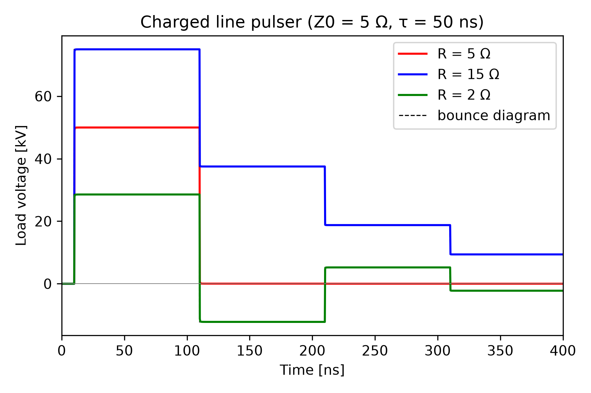

# Charged Transmission Line Pulser

Philip Mocz (2026)

A transmission line charged to V0 is discharged by a triggered gas switch
into a resistive load. This is the classic way to make a flat, fast pulse in
pulsed power (e.g. a water-dielectric pulse-forming line). The example uses
the lossless transmission line (`add_transmission_line`) and the triggered
switch (`add_switch`).


## Circuit

```
         switch (closes at t_close)
 n3+-------/ ------------+n1==================================+n2
   |                     |      line: Z0 = 5 Ω, tau = 50 ns   |  (open end)
 [ R ]                   |       charged to V0 = 100 kV       |
   |                     |                                    |
 n0+---------------------+------------------------------------+
```


## Usage

```console
python charged_line_pulser.py [--plot]
```


## Parameters

| Symbol | Value | Description |
|--------|-------|-------------|
| Z0 | 5 Ω | Line impedance |
| tau | 50 ns | One-way transit time (pulse length 2 tau = 100 ns) |
| V0 | 100 kV | Charge voltage (50 J stored) |
| t_close | 10 ns | Switch trigger time |
| t_rise | 1 ns | Switch closing time scale (10-90% in about 3.4 ns) |
| r_on | 5 mΩ | Switch on-resistance |
| dt | 0.25 ns | Time step (tau = 200 steps) |


## Bounce diagram

When the switch closes, a wave of amplitude -V0/2 runs down the line,
reflects off the open end, and returns after 2 tau. Each time it reaches the
load, a fraction G = (R_eff - Z0)/(R_eff + Z0) is reflected, where R_eff = R
+ r_on. The load voltage is a staircase of 2 tau steps:

```
V_k = V0 (1 + G)/2 · G^k · R/R_eff,      k = 0, 1, 2, ...
```

| Load | G | Behaviour |
|------|---|-----------|
| R = Z0 (matched) | ≈ 0 | One clean V0/2 pulse that takes all the energy |
| R > Z0 | > 0 | Higher first step, decaying staircase of the same sign |
| R < Z0 | < 0 | Lower first step, then steps alternating in sign |


## Results

spicex matches the bounce diagram at every plateau to the printed precision
(0.1 V on 100 kV):

| R (Ω) | k = 0 | k = 1 | k = 2 |
|-------|-------|-------|-------|
| 5 | 49.975 kV | 0.025 kV | 0 kV |
| 15 | 74.981 kV | 37.500 kV | 18.755 kV |
| 2 | 28.551 kV | −12.207 kV | 5.219 kV |

The transmission line is exact here: it uses the method of characteristics,
with tau a whole number of time steps. The load and switch are resistive, so
backward Euler adds no error on the plateaus.

Gradient-based optimisation (`spicex.optimize`) of the energy delivered in
the first pulse window finds R = 5.006 Ω. This takes 49.8 J, 99.6% of the
stored energy. The ideal matched load is Z0 - r_on = 4.995 Ω. The 0.2%
difference comes from the switch's finite closing time, which smears the
pulse edges across the fixed window.


