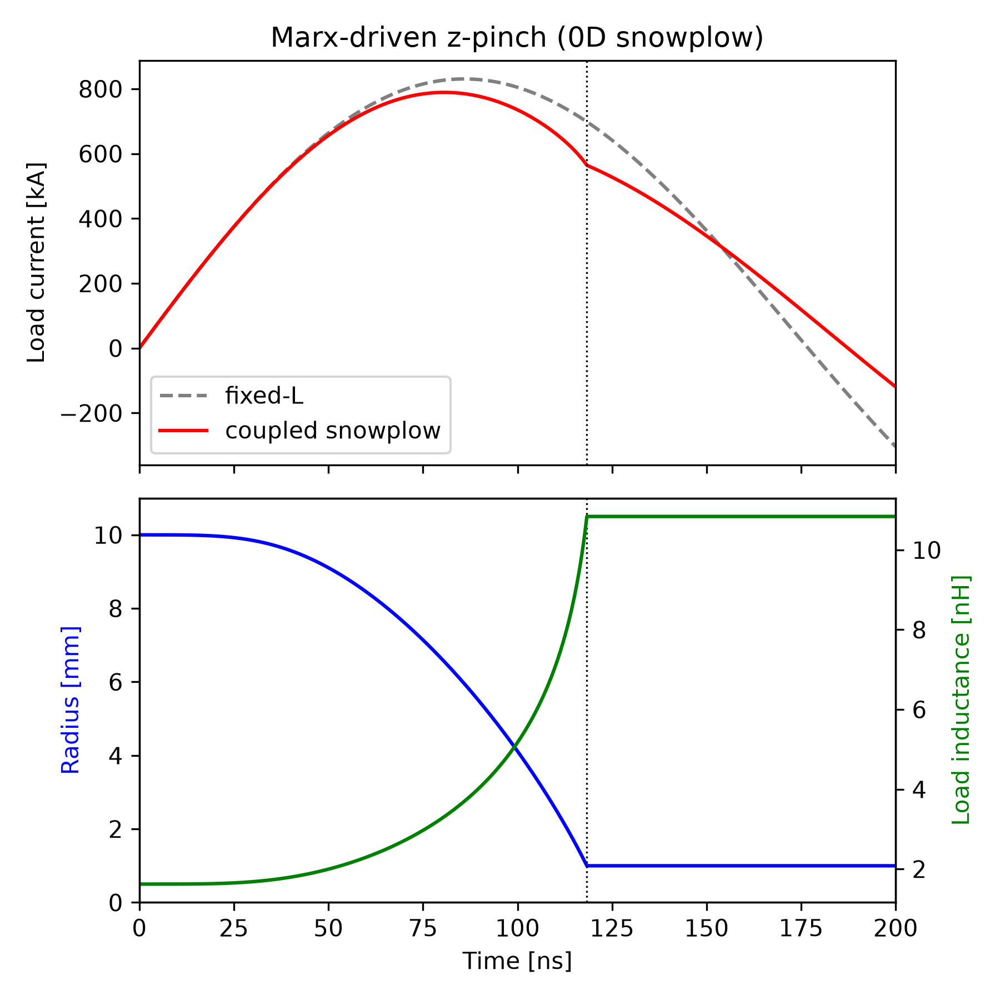

# Z-Pinch Driven by a Marx Generator (0D Snowplow)

Philip Mocz (2026)

A Marx generator drives an imploding z-pinch. The load is a time-varying
inductor whose value follows a 0D snowplow model of the plasma shell. Its
equation of motion is solved alongside the circuit through the `update_fn`
hook of `Circuit.solve_transient()`.


## Circuit

The Marx is shown erected: N stages of C_s charged to V_c act as one
capacitor C_s/N charged to N·V_c, with the N spark gaps in series.

```
 n1+---[ R=N·R_s ]---+n2---[ L=N·L_s ]---+n3---[ L_line ]---+n4
   |                                                        |
   |  +                                                     |
 [ C=C_s/N ]  V(0)=N·V_c                                [ L_p(r(t)) ]  z-pinch load
   |                                                        |
 n0+--------------------------------------------------------+
```

The load is a cylindrical shell of height h at radius r(t) inside a
return-current can of radius b:

```
      return can (radius b)
   |                      |
   |    |            |    |       L_p(r) = (mu0 h / 2 pi) ln(b / r)
   |    |  <-  r  -> |    |
   |    |   shell    |    |       m(r) = m_liner + pi rho0 (r0^2 - r^2)
   |    |   moves    |    |
   |    |   inward   |    |       d(m v)/dt = -mu0 I^2 / (4 pi r)
   |    |            |    |
   +----+------------+----+
            anode
```


## Usage

```console
python z_pinch_snowplow.py [--plot]
```


## Parameters

| Symbol | Value | Description |
|--------|-------|-------------|
| N | 10 | Marx stages |
| C_s | 1.0 µF | Capacitance per stage |
| V_c | 50 kV | Charge voltage per stage (erected 500 kV, 12.5 kJ) |
| L_s, R_s | 2 nH, 5 mΩ | Spark gap, per stage |
| L_line | 10 nH | Output line and feed |
| r0, b, h | 10, 15, 20 mm | Initial radius, return radius, height |
| m_liner | 10 µg/cm | Initial shell mass |
| rho0 | 0.01 kg/m³ | Gas fill swept up by the shell (31 µg/cm in total) |
| r_min | 1 mm | Stagnation radius (convergence ratio 10) |
| dt | 20 ps | Time step |


## Coupling

The circuit sees the load as a variable inductor (`add_variable_inductor`):

```
V_load = d(L_p I)/dt = L_p dI/dt + I dL_p/dt
```

spicex integrates this with a flux-conserving backward Euler step. At the
start of every step, `update_fn` advances the shell (r, m v) using the
previous step's current, then returns the new L_p(r). Once the shell passes
r_min, its motion is stopped and L_p is held fixed. `spicex.first_crossing`
interpolates the stagnation time between samples. This makes the implosion
time a smooth function of the design parameters, so it can be differentiated
with `jax.grad`.


## Results

| Quantity | Value |
|----------|-------|
| Implosion time | 118.3 ns |
| Peak current | 789 kA at 80.7 ns |
| Current at stagnation | 564 kA |
| Work done on the load, ∫ ½ I² dL_p | 2.14 kJ |
| Shell kinetic energy at stagnation | 1.77 kJ |
| Energy balance error | 7e-4 |

The run agrees with a tight-tolerance `scipy` (DOP853) integration of the same
equations. The implosion-time error is 12 ps at dt = 20 ps and halves with
dt, as expected for a first-order method. The gradients of the implosion time
with respect to V_c, m_liner and L_line match central finite differences to
about 1e-4.

The script also runs two shortcuts, and both get the timing wrong:

- **Fixed-inductance load:** the current peaks at 85.9 ns at 830 kA. That is
  41 kA higher than the coupled run, and the dip at stagnation is missing.
- **One-way coupling:** the shell moves, but its dL_p/dt voltage is not fed
  back to the circuit. It implodes 2.8 ns early.

Beyond stagnation the model is no longer physical: the 0D snowplow has no
pinch dynamics, so the shell is simply held at r_min.


